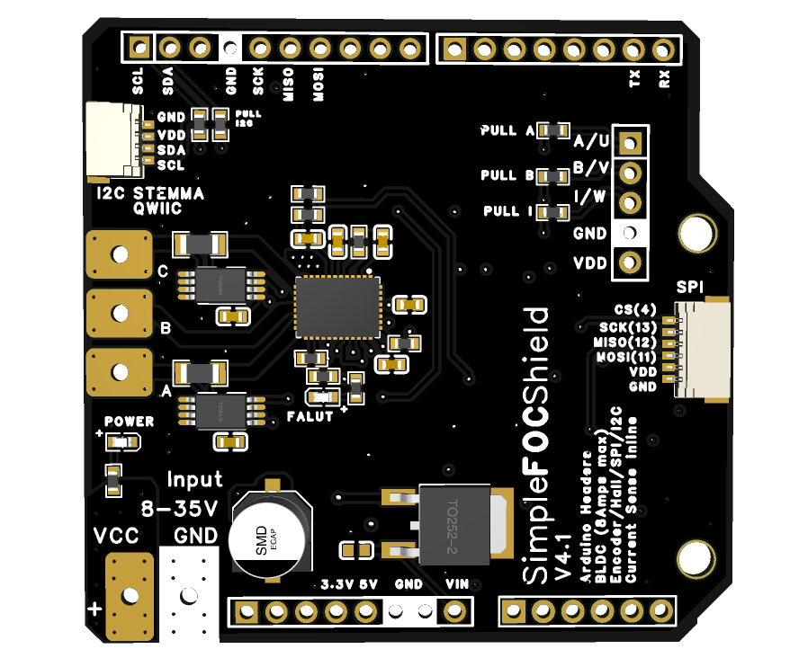
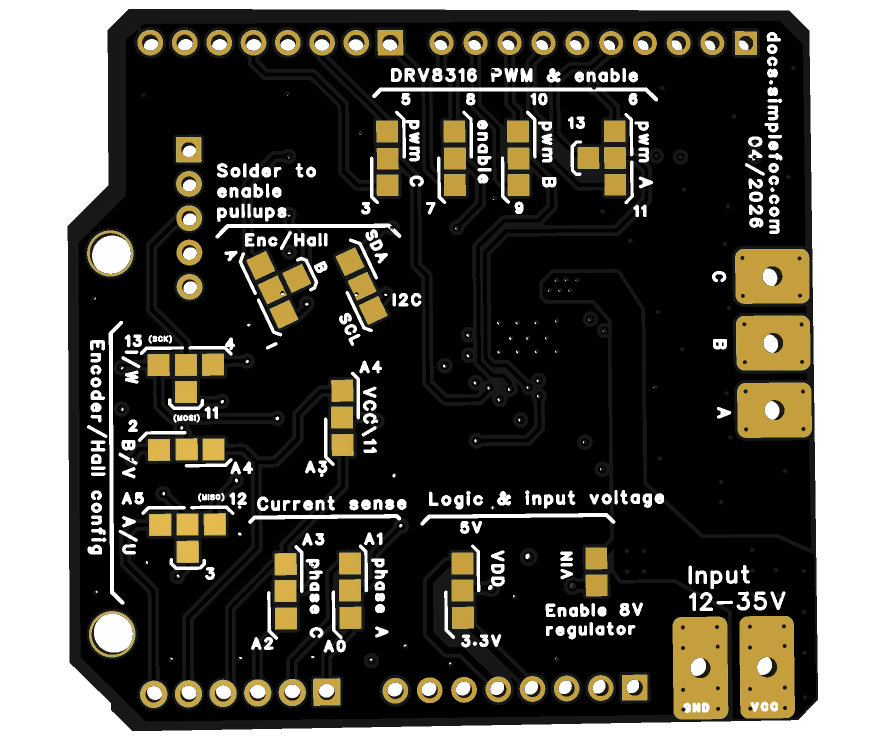
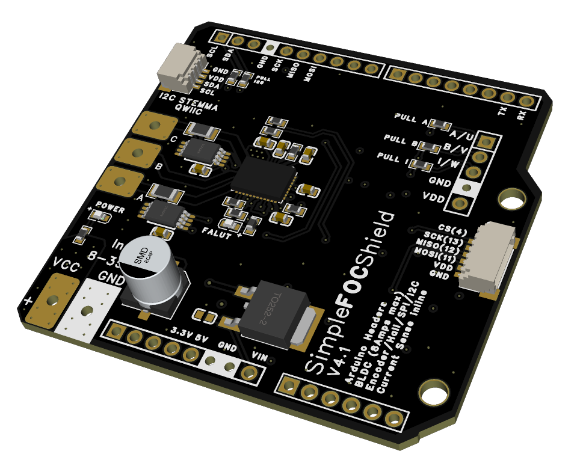
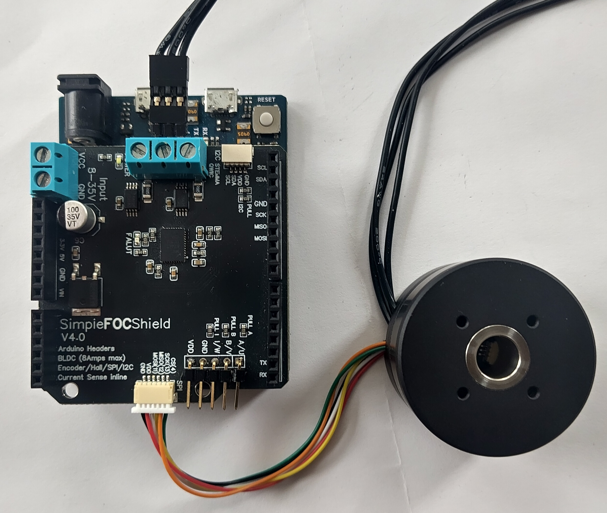
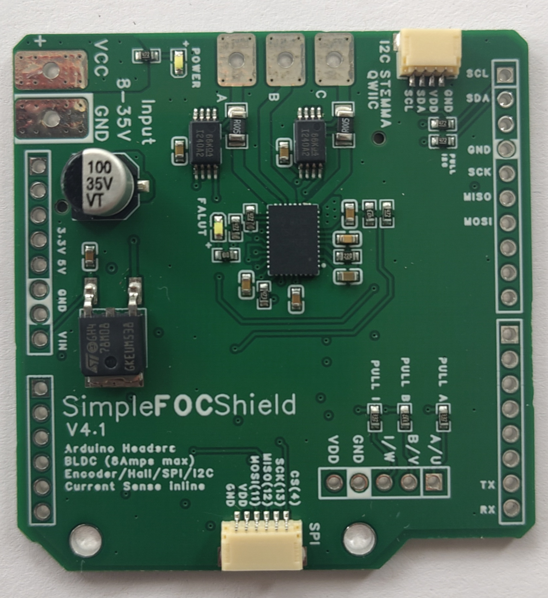
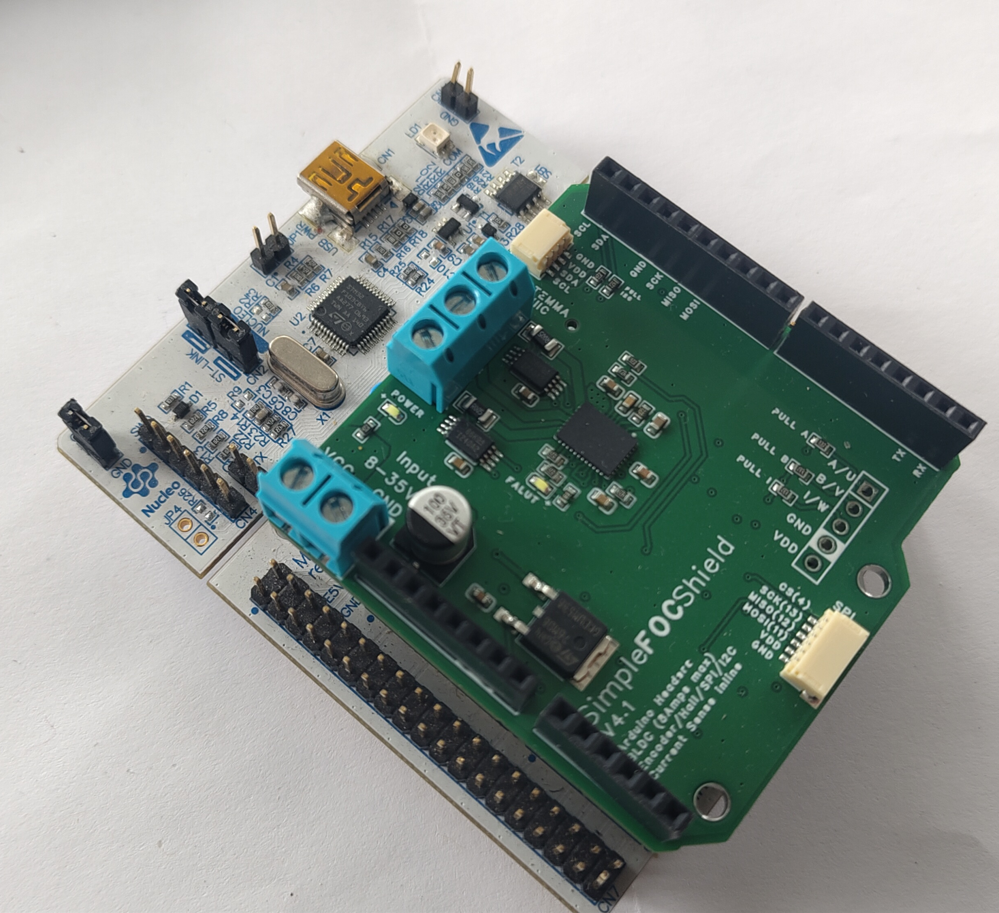
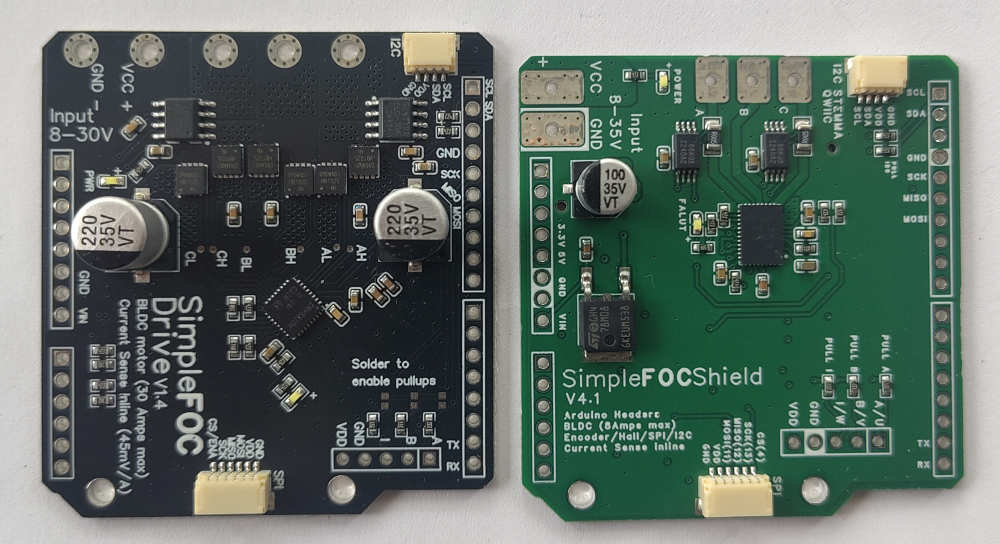
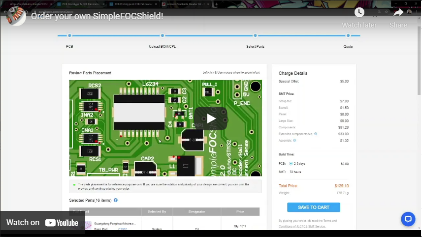

# Arduino *Simple**FOC**Shield* *v4.1*

  

This is an open-source low-cost Brushless DC (BLDC) motor driver board intended primarily for low-power FOC applications up to 5Amps. The board is fully compatible with the Arduino UNO and all the boards with the standard Arduino headers. The *Simple**FOC**Shield*, in combination with the *Simple**FOC**library* provides user-friendly way to control BLDC motors both in hardware and software. 

### Features
- **Plug & play**: In combination with Arduino *Simple**FOC**library* - [github](https://github.com/simplefoc/Arduino-FOC)
- **Low-cost**: Price of 15-30€ - [Check the pricing](https://www.simplefoc.com/shop) 
- **In-line current sensing**: Up to 10Amps bidirectional
   - INA240 inline current sense amps (Gain 50, shunt 5mΩ)
- **Integrated 8V regulator**: 
   - Enable/disable by soldering pads
- **Absolute max ratings** - Designed for mid-power motors (preferably gimbals). 
   - Max current: 8A/10A (3-5A continous), 
   - Max input voltage: 35V
- **Power supply voltage sensing**: Optional volatge divisor 4.7kΩ/47kΩ (1/11)
- **Stackable**: running 2 motors in the same time
- **Encoder/Hall sensors interface**: Integrated 3.3kΩ pullups (configurable)
- **I2C interface**: Integrated 4.7kΩ pullups (configurable)
- **Configurable pinout**: Hardware configuration - soldering connections
- **QWIIC/STEMMA** compatible**: The board now has the 4-pin JST i2c connector to enable easy upgrades of your projects
- **SPI connector**: 6-pin JST connector for easy connection of SPI sensors (stacking not possile)
- **Arduino headers**: Arduino UNO, Arduino MEGA, STM32 Nucleo boards...
- **Open Source**: 
   - Fully designed in **EasyEDA**: [EasyEDA project](https://oshwlab.com/the.skuric/project_mzcekczw) 🎉
   - Fully available fabrication files - [how to make it yourself](https://docs.simplefoc.com/arduino_simplefoc_shield_fabrication)

### New Features v4.x
 - Transition away from stm's DRV8313 chip to [DRV8316](https://www.ti.com/lit/ds/symlink/drv8316.pdf), with higher current capacity
 - Transition form ACS712 hall sensor amps to TI's [INA240](https://www.ti.com/lit/ds/symlink/ina240.pdf) amps 
 - Power supply volatge sennsing
 - Designed completely in **EasyEDA PRO**, which is a free online PCB design tool - **[Official Easy EDA project](https://oshwlab.com/the.skuric/project_mzcekczw)**
 - Added **SPI** and **QWIIC/STEMMA** connectors

Comparison to the Drive shield

### Short YouTube demonstration video (Old and somewhat outdated)

### Short video guide to fabricating your own *Simple**FOC**Shield* (Old and potentially outdated)

More info on [board fabrication docs](https://docs.simplefoc.com/arduino_simplefoc_shield_fabrication).

## Board versions:

Feature | SimpleFOCShield v1.x | SimpleFOCShield v2.x | SimpleFOCShield v3.x | SimpleFOCShield v4.x |
|-|-|-|-|-|
|||||
**PWM Driver** | [L6234](https://www.st.com/resource/en/datasheet/l6234.pdf) | [L6234](https://www.st.com/resource/en/datasheet/l6234.pdf) | [DRV8313](https://www.ti.com/lit/ds/symlink/drv8313.pdf?ts=1719165774986&ref_url=https%253A%252F%252Fwww.google.com%252F) | [DRV8316](https://www.ti.com/lit/ds/symlink/drv8316.pdf)
**Current Sense** | ❌ | [INA240](https://www.ti.com/lit/ds/symlink/ina240.pdf?ts=1719180172738) | [ACS712](https://www.allegromicro.com/en/products/sense/current-sensor-ics/zero-to-fifty-amp-integrated-conductor-sensor-ics/acs712) | [INA240](https://www.ti.com/lit/ds/symlink/ina240.pdf?ts=1719180172738)
**Current measurement range** | ❌ | (configurable) ±3.3/5Amps | ±5Amps | (configurable) ±8A@3.3V or ±10A@5V
**Onboard LDO** | ❌ | LM7808 | LM7808 | LM7808
**Stackable** | ✔️ | ✔️ | ✔️ | ✔️
**Max current** | 2Amps (5Amp peak) | 2Amps (5Amp peak) | 2Amps (3Amp peak) | 5Amps (8Amps)
**Max voltage** | 24V | 35V | 35V | 35V
**Protections** | Overtemperature | Overtemperature | Overtemperature, Overcurrent | UVLO, CPUV, OCP, OTW/OTSD
**Footprint** | 68mm x 53 mm | 68mm x 53 mm | 56mm x 53mm | 56mm x 53mm
**Design tool** | Altium Designer 2019 | Altium Designer 2019 | EasyEDA | EasyEDA PRO 
**QWIIC/STEMMA connector** | ❌ | ❌ | ❌ | ✔️
**SPI connector** | ❌ | ❌ | ❌ | ✔️

## Release timeline

To check the release timeline, click [here](https://github.com/simplefoc/Arduino-SimpleFOCShield/releases) 

Version  |link | Release date | Comment
----- | ----- | ---- | ----
*Simple**FOC**Shield* v1.3 |[release v1.3](https://github.com/simplefoc/Arduino-SimpleFOCShield/releases/tag/v1.3) | 04/20 | Inital release
*Simple**FOC**Shield* v1.3.1 | [release v1.3.1](https://github.com/simplefoc/Arduino-SimpleFOCShield/releases/tag/v1.3.1) | 07/20 | added Nucleo stacking support
*Simple**FOC**Shield* v1.3.2 |[release v1.3.2](https://github.com/simplefoc/Arduino-SimpleFOCShield/releases/tag/v1.3.2) | 09/20 | added I2C pullups
*Simple**FOC**Shield* v1.3.3 |[release v1.3.3](https://github.com/simplefoc/Arduino-SimpleFOCShield/releases/tag/v1.3.3) | 12/20 | adapted L6234 circuit + full Arduino header
*Simple**FOC**Shield* v2.0 |[release v2.0](https://github.com/simplefoc/Arduino-SimpleFOCShield/releases/tag/v2.0) | 01/21 | - 3A in-line current sensing  - 5V regulator  - new pinout for hardware config 
*Simple**FOC**Shield* v2.0.1 |[release v2.0.1](https://github.com/simplefoc/Arduino-SimpleFOCShield/releases/tag/v2.0.1) | 01/21 | - reduced via size   - configurable range
*Simple**FOC**Shield* v2.0.2 |[release v2.0.2](https://github.com/simplefoc/Arduino-SimpleFOCShield/releases/tag/v2.0.2) | 02/21 | replaced 7805(connected to 5V) with 78M08 (connected to VIN) to be compatible with stm32 Nucleo-64
*Simple**FOC**Shield* v2.0.3 |[release v2.0.3](https://github.com/simplefoc/Arduino-SimpleFOCShield/releases/tag/v2.0.3) | 03/21 | - Shortened the lines from ADC to current sense   - Typo fix : underside label switched phase A and phase B
*Simple**FOC**Shield* v2.0.4 |[release v2.0.4](https://github.com/simplefoc/Arduino-SimpleFOCShield/releases/tag/v2.0.4) | 09/21 | - Pullup config simplified   - Max input voltage 35V   - removed CAP2 for a CL1   - Easy EDA version of the project
*Simple**FOC**Shield* v3.1 |release v3.1 | 10/22 | - Complete redesign   - Transition to DRV8313   - Transition to ACS712   - Smaller footprint: 56mm x 53mm  - Fault and reset pins exposed (optional)   - Fault led indication  - Fully developed using EasyEDA
*Simple**FOC**Shield* v3.2 |[release v3.2](https://github.com/simplefoc/Arduino-SimpleFOCShield/releases/tag/v3.2) | 04/24 | - Official release   - Resolved the bug [#9](https://github.com/simplefoc/Arduino-SimpleFOCShield/issues/9)
*Simple**FOC**Shield* v4.1 |[release v4.1](https://github.com/simplefoc/Arduino-SimpleFOCShield/releases/tag/v4.1) | 04/26 | - Official v4 release   - transition to DRV8316   - transition to INA240 amps   - Added stemma/qwiic support   - Added SPI JST connector  

## Getting started
You already have your own SimpleFOCShield?  
[Here is a simple guide how to start preparing your setup](https://docs.simplefoc.com/arduino_simplefoc_shield_installation)

## How to get hold of the *SimpleFOCShield*
- **Fabricate the board yourself**:  Please visit the [board fabrication](https://docs.simplefoc.com/arduino_simplefoc_shield_fabrication) to find out how to manufacture the board yourself! 
- **Order the finished and tested board**:  Check out our [shop](https://simplefoc.com/simplefoc_shield_product).
